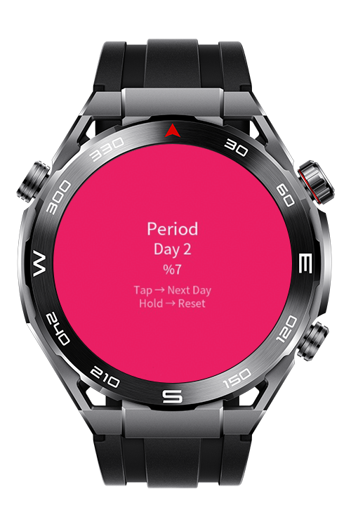
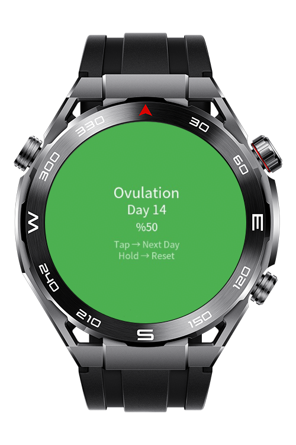
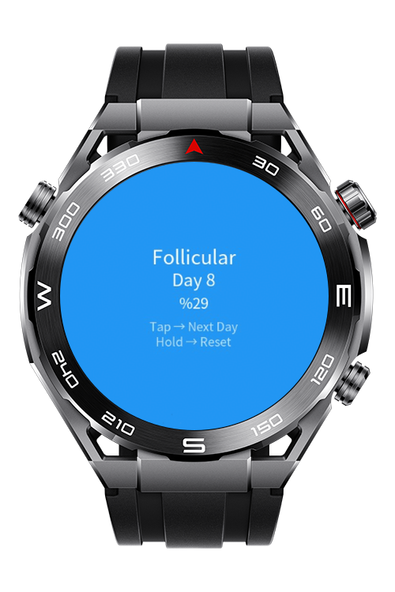

> **Note:** To access all shared projects, get information about environment setup, and view other guides, please visit [Explore-In-HMOS Index](https://github.com/Explore-In-HMOS/hmos-index).

# How To Monitor Periods
A lightweight wearable-friendly period tracking codelab built for Huawei Lite Wearable devices.  
Designed to demonstrate cycle calculation, phase detection, and simple persistent storage logic

# Preview

<div>
  
  
  

</div>

# Use Cases
- Track menstrual cycle day based on last period start date
- Automatically calculate cycle phase (Period / Follicular / Ovulation / Luteal)
- Persist cycle data locally using device storage
- Simple tap interaction to simulate cycle progression
- Long press to reset cycle

# Tech Stack
- **Languages**: HML, JS
- **Frameworks**: 5.0.0(12)
- **Tools**: DevEco Studio Version 6.0.0
- **Libraries**: @system.wearengine, @ohos.router

# Directory Structure

```
entry/
├── src/main/js/MainAbility/
│ ├── app.js
│ ├── pages/
│ │ └── index/
│ │     ├── index.css
│ │     ├── index.hml
│ │     └── index.js
```

# Constraints and Restrictions

## Supported Devices

* Huawei Sport (Lite) Watch GT 4/5/6
* Huawei Sport (Lite) GT4/5 Pro
* Huawei Sport (Lite) Fit 3/4
* Huawei Sport (Lite) D2
* Huawei Sport (Lite) Ultimate
* DevEco Studio Simulator

# License (MIT)

How To Monitor Periods is distributed under the terms of the MIT License. See the [LICENSE](./LICENSE) for more information.